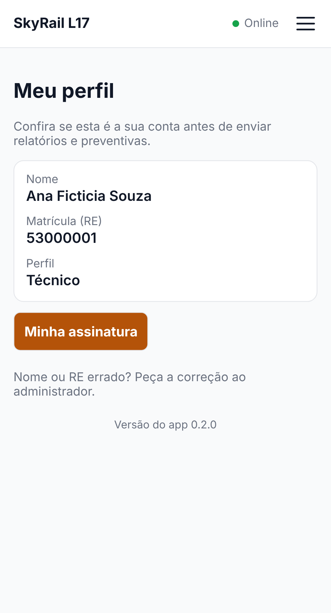
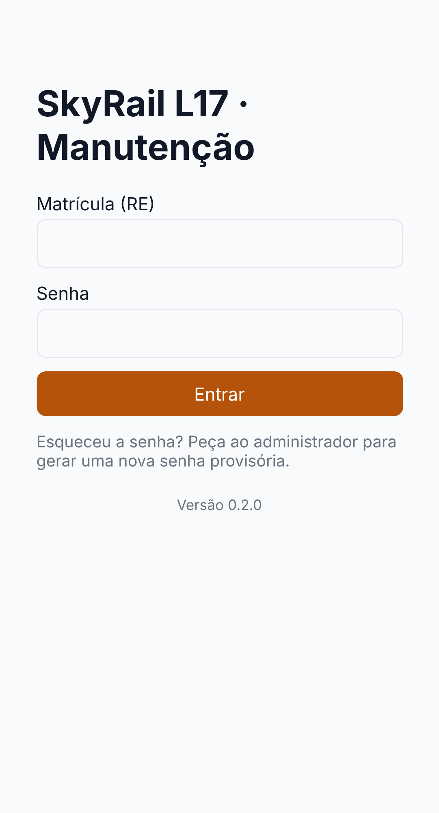
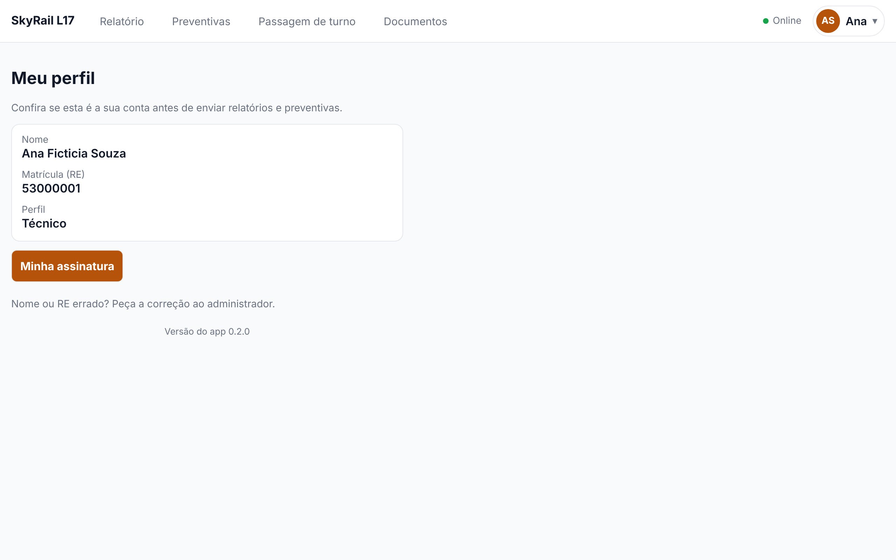

## O que muda
- `package.json` em **0.2.0**, a versão de testes do Marco 2. Formato `0.<marco>.<correção>`: a 1ª rodada de correções será 0.2.1.
- A versão é injetada no build (`__APP_VERSION__`) e aparece em **Meu perfil** ("Versão do app 0.2.0") e na tela de login.
- `dist/versao.json` passa a trazer `versao` além do `commit` (o teste de homologação continua usando o `commit`).
- `CHANGELOG.md` com o que mudou para o usuário nesta versão; é a base do aviso de alteração do Anexo III.

Sem mudança de banco nem de RLS.

## Base
PR contra `homologacao`. Primeiro da pilha (depois vêm a política de uso e os avisos), nesta ordem.

## Prova de teste
- `tsc -b`, `npx oxlint src`, `npm test` e `npm run build` passando.
- App aberto no navegador com **servidor Supabase simulado** e **dados fictícios** ("Ana Ficticia Souza", RE 53000001).

| Meu perfil (Pixel 5) | Login (Pixel 5) | Meu perfil (PC 1280 px) |
|---|---|---|
|  |  |  |

Refs #24
