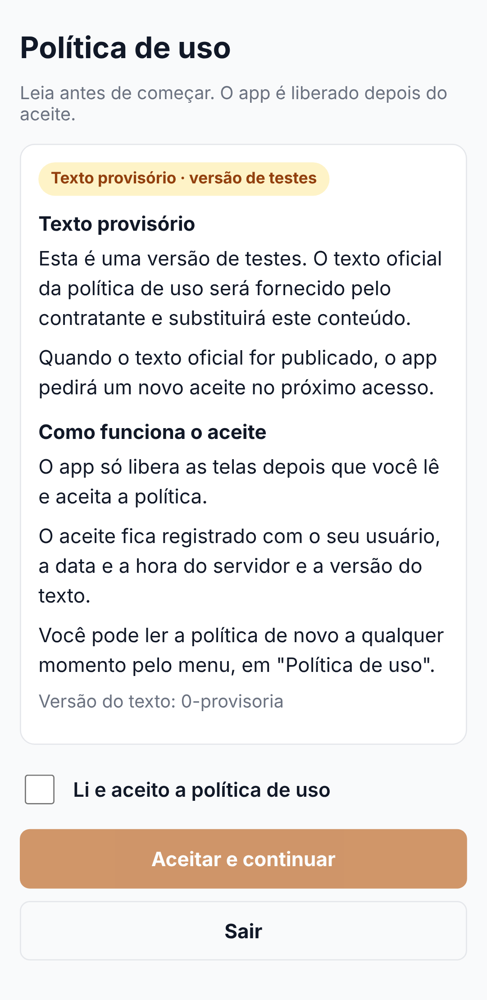
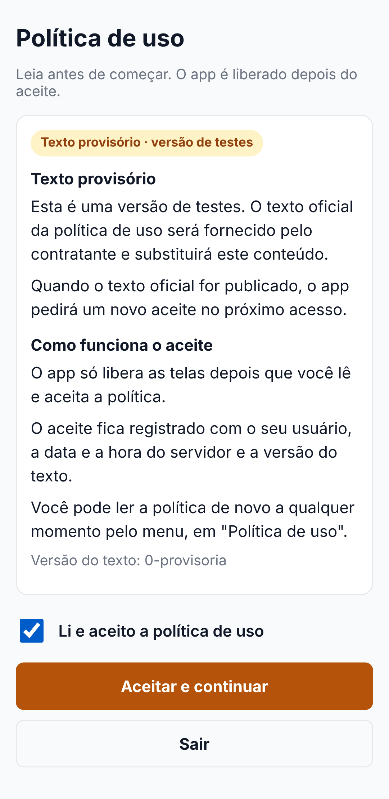
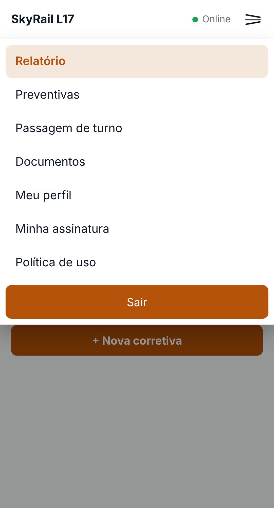
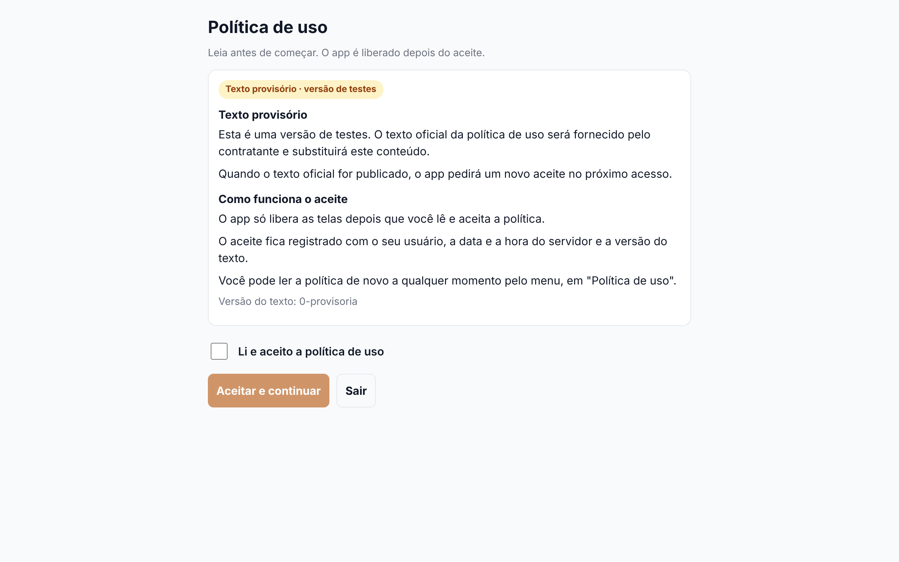
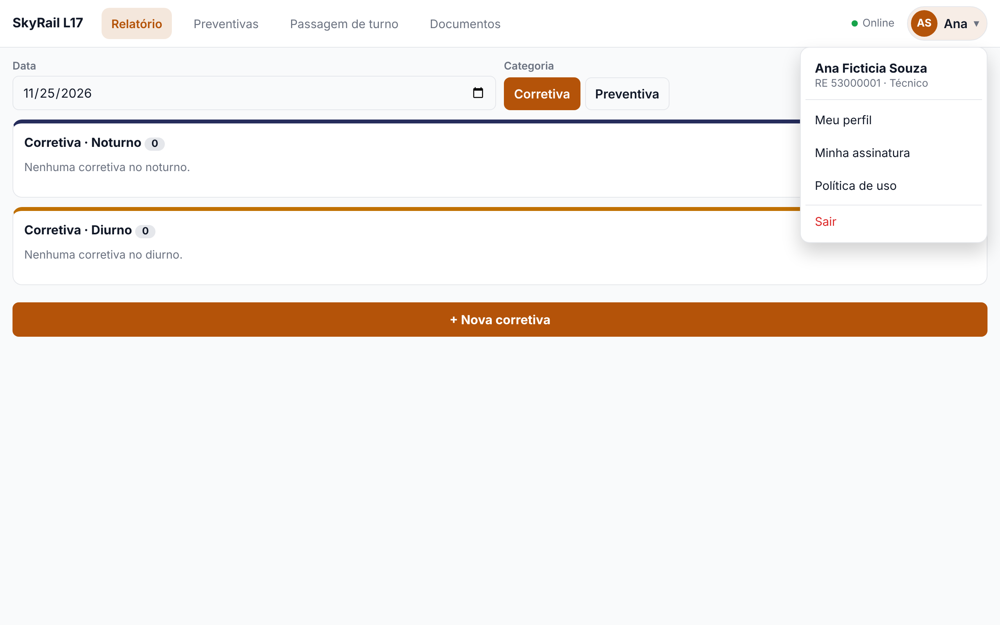
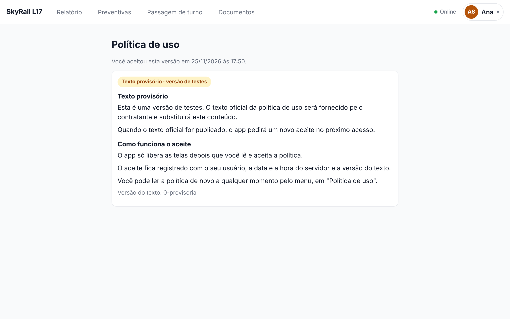

## O que muda
- Depois do login (e da troca de senha, no primeiro acesso), o app mostra a **política de uso** e só libera as telas
  depois de marcar "Li e aceito" e tocar em **Aceitar e continuar**.
- Aceite gravado no banco: usuário, **data e hora do servidor** e versão do texto. Mudou a versão, todos aceitam de novo.
- Depois do aceite, o aparelho guarda a versão aceita, para o app abrir sem internet em campo.
  Sem internet no primeiro acesso, a tela explica e oferece "Tentar de novo".
- Página **Política de uso** no menu (celular) e no menu da conta (PC), com a data do aceite.
- **Texto provisório**, com selo "Texto provisório · versão de testes". O texto oficial depende do contratante
  (Cláusula 8.2); quando chegar, basta trocar `SECOES` e subir `VERSAO_POLITICA` em `src/modules/politica/domain/politica.ts`.
- Manual de uso atualizado.

## Banco
- Migração `0007_aceite_politica.sql`: tabela `aceites_politica` com RLS.
  Cada um grava só o próprio aceite (usuário ativo); supervisor e admin leem todos; ninguém altera nem apaga pelo app.
  A data enviada pelo aparelho é ignorada (trigger usa `now()`).
- Testes em `supabase/tests/rls_aceite_politica.sql` (13 casos).
- `scripts/testar-homol.mjs` agora confere se a tabela existe no Supabase de homologação.
- **Aplicar a 0007 no Supabase de homologação antes do merge.**

## Base
PR contra `homologacao`. Vem depois do PR da versão.

## Prova de teste
- `tsc -b`, `npx oxlint src scripts`, `npm test`, `npm run build` e `scripts/test-db.sh` (RLS em Postgres 16 local) passando.
- App aberto no navegador com **servidor Supabase simulado** e **dados fictícios** ("Ana Ficticia Souza", RE 53000001).
  O clique em "Aceitar e continuar" enviou `{"versao":"0-provisoria"}` para `aceites_politica`.

| Primeiro acesso (Pixel 5) | Marcado (Pixel 5) | Menu (Pixel 5) | Sem conexão (Pixel 5) |
|---|---|---|---|
|  |  |  |  |

| Primeiro acesso (PC 1280 px) | Menu da conta (PC) | Consulta com data do aceite (PC) |
|---|---|---|
|  |  |  |

Refs #18 (fica aberta até o texto oficial do contratante entrar)
