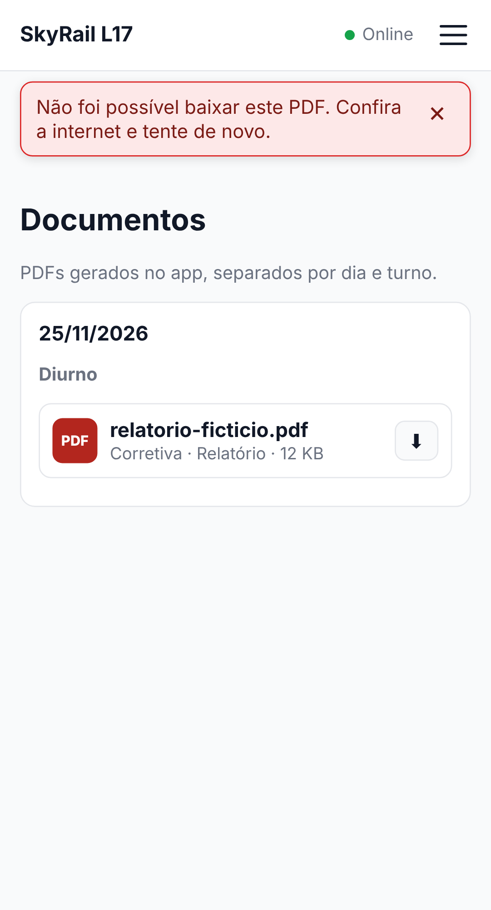
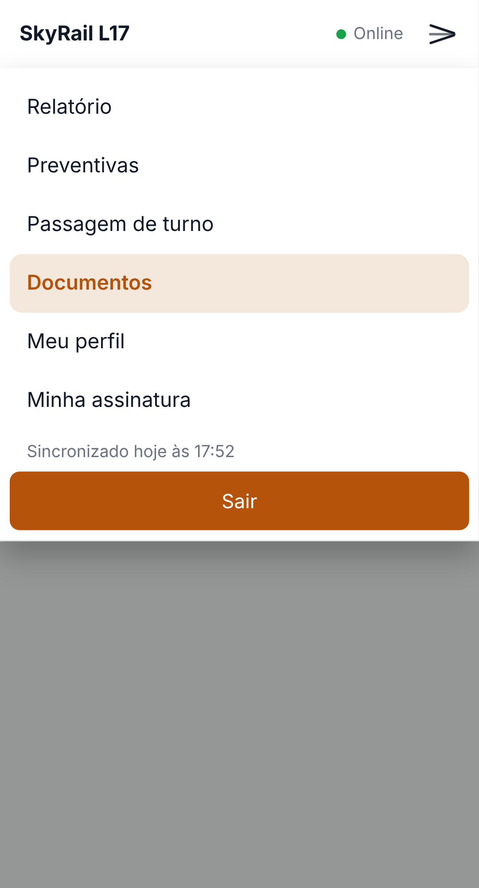
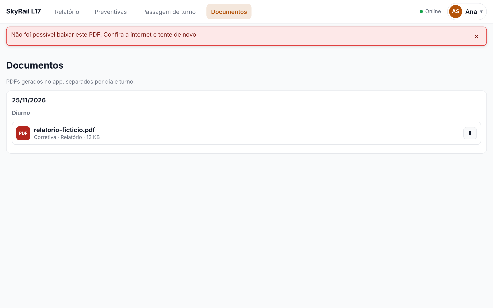
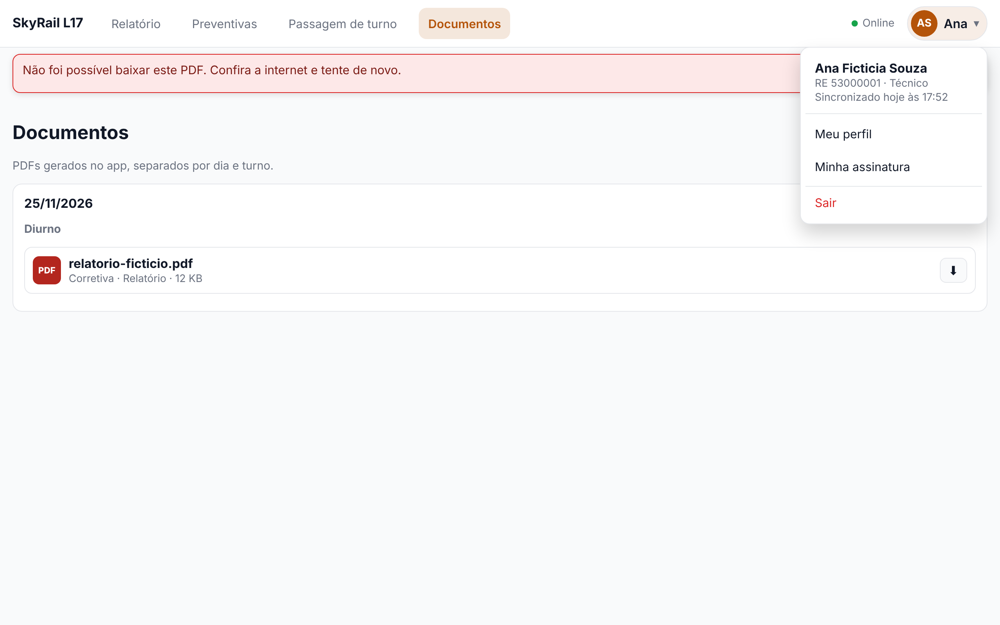

## O que muda
- Os **11 `alert()`** que sobraram (gerar PDF, assinar, excluir atividade, baixar documento, adicionar foto) viram
  o aviso na tela que já existe para o envio: não trava o app e some ou fica conforme o tipo (ok, atenção, erro).
  Os `confirm()` de excluir e assinar continuam, porque pedem uma decisão.
- **Hora da última sincronização** sem erro: "Sincronizado hoje às 17:52" (ou ontem, ou dd/mm), no horário de São Paulo.
  Aparece no menu do celular e no menu da conta no PC. Fica guardada no aparelho, separada por pessoa.
- Regra do texto em `src/domain/sincronizacao.ts`, com testes.

Sem mudança de banco nem de RLS.

## Base
PR contra `homologacao`. Vem depois do PR da política de uso.

## Prova de teste
- `tsc -b`, `npx oxlint src`, `npm test` (179 testes), `npm run build` e `scripts/test-db.sh` passando.
- App aberto no navegador com **servidor Supabase simulado** e **dados fictícios** (documento "relatorio-ficticio.pdf"
  com falha simulada no download). Nenhuma caixa de `alert` apareceu.

| Aviso no lugar do alert (Pixel 5) | Última sincronização (Pixel 5) | Aviso (PC 1280 px) | Última sincronização (PC) |
|---|---|---|---|
|  |  |  |  |
