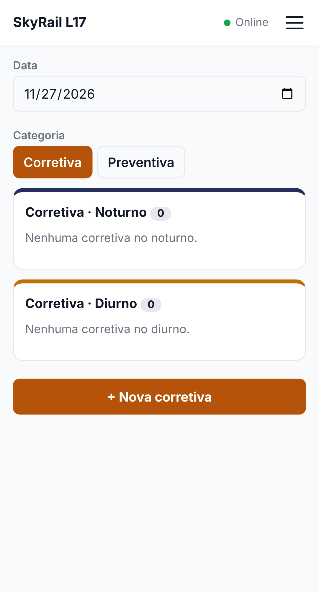
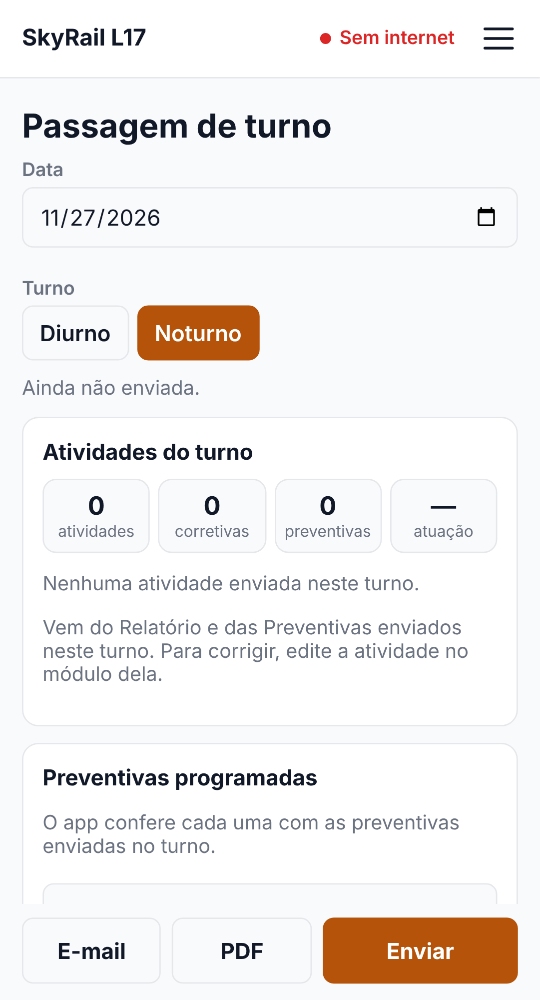
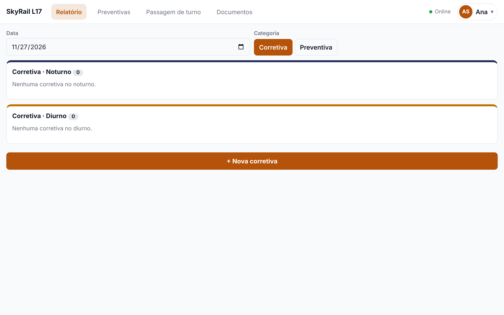
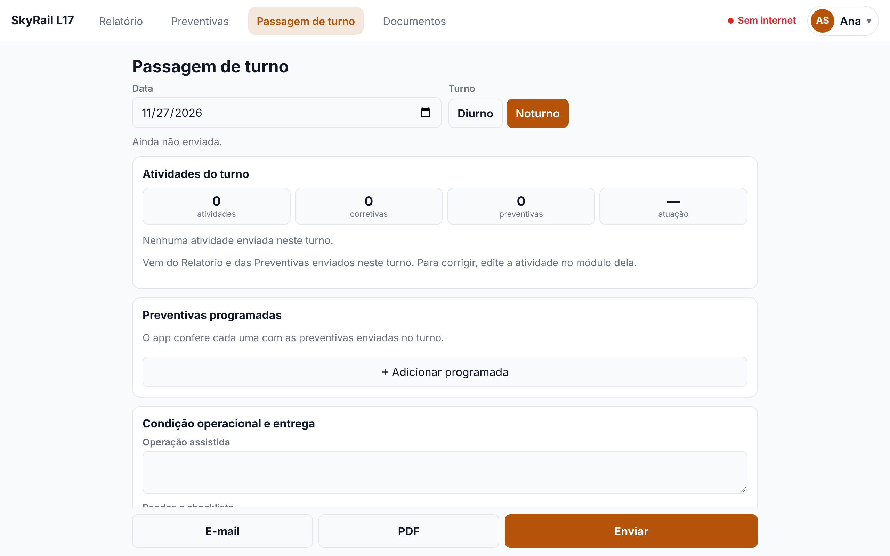

## O que muda
- Bibliotecas em arquivos próprios (`react`, `supabase`, `dexie`). Nenhum arquivo passa de 500 KB e o build não avisa mais.
  Numa entrega nova, o celular baixa de novo só o código do app (~40 KB), não as bibliotecas.
- Menu, filas e cada tela são carregados sob demanda pelo roteador, com a mesma recarga automática
  quando um deploy novo apagou o arquivo antigo. A tela de login não carrega mais o Dexie.
- pdf-lib continua carregado só ao gerar PDF (já era assim).
- O service worker guarda todas as telas: sem internet, elas abrem do cache.

## Medição (Lighthouse 12, /login, tela do Pixel 5, 4G simulado, 3 rodadas cada)
| | Antes (`homologacao`) | Depois |
|---|---|---|
| Nota de desempenho | 96–97 | 97 |
| Peso total | 219 KiB | 166 KiB |
| FCP | 2,1–2,2 s | 2,0 s |
| LCP | 2,2–2,3 s | 2,1 s |
| TBT | 40–110 ms | 0–10 ms |

## Prova de teste
- `tsc -b`, `npx oxlint src`, `npm test` (179 testes) e `npm run build` (sem aviso de chunk) passando.
- Build de produção servido localmente com **servidor Supabase simulado** e **dados fictícios**: abri Relatório,
  Preventivas, Passagem, Documentos, Meu perfil, Política e Minha assinatura sem erro de JS; depois, **sem internet**,
  a Passagem abriu do cache do service worker.

| Relatório (Pixel 5) | Passagem sem internet (Pixel 5) | Relatório (PC 1280 px) | Passagem sem internet (PC) |
|---|---|---|---|
|  |  |  |  |

Closes #30
