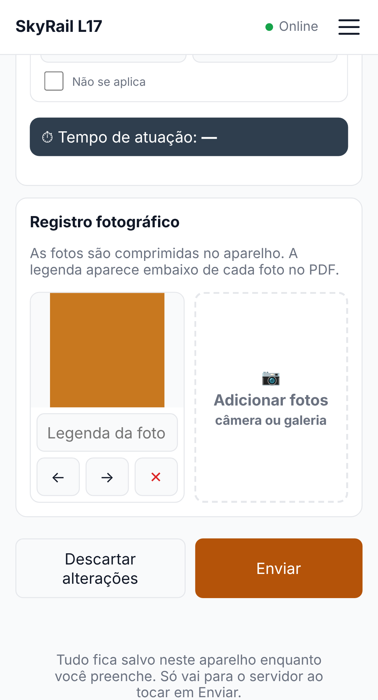
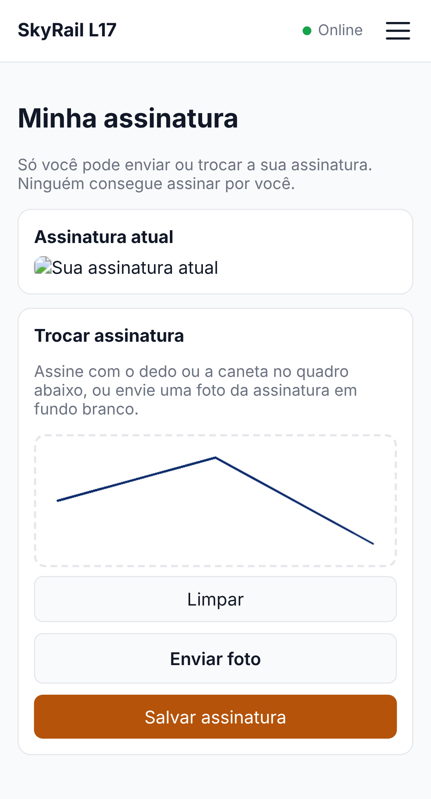
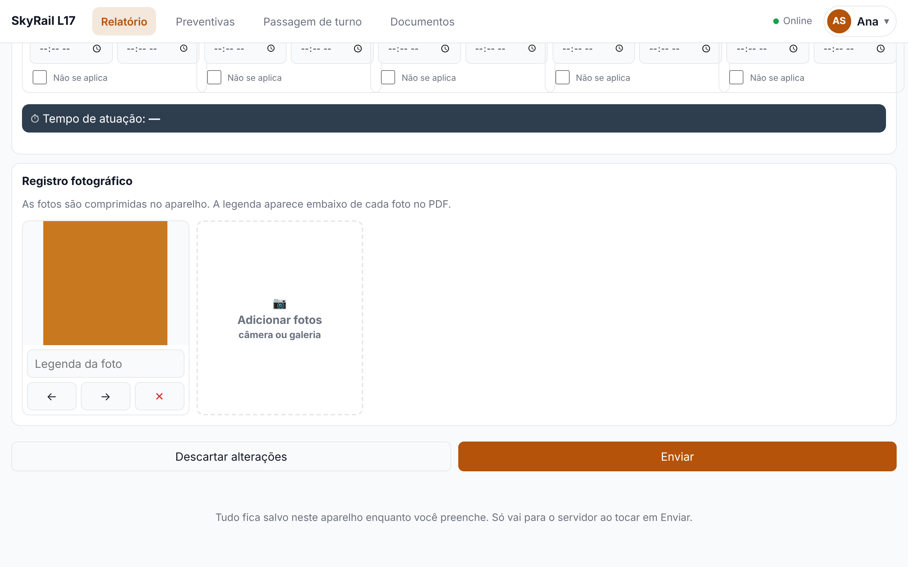
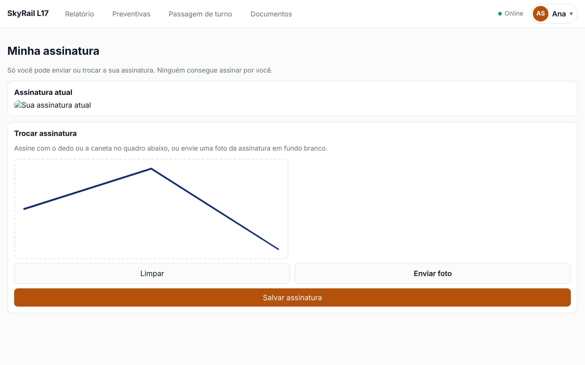

## O que muda
- `scripts/gerar-csp.mjs` roda no fim do build e grava `dist/_headers` com a Content-Security-Policy
  (a Netlify junta com os headers do `netlify.toml`).
- Código só do próprio site (`script-src 'self'`, sem script inline); conexões e imagens só do Supabase
  do ambiente publicado, lido de `VITE_SUPABASE_URL` (homologação usa o de homol, produção o de produção);
  `blob:` para as miniaturas das fotos; sem `object`, sem ser aberto dentro de outro site (`frame-ancestors 'none'`).
- Sem URL no build (ex.: CI), aceita qualquer `*.supabase.co`.
- O teste de homologação confere se o header foi publicado e se libera o Supabase de homol.

## Prova de teste
- `npx oxlint src scripts`, `npm run build` e checagem de segredos do `dist` passando.
- Build servido localmente **com o header CSP aplicado**, **servidor Supabase simulado** e **dados fictícios**:
  aceite da política, todas as telas, foto adicionada na corretiva (miniatura `blob:` carregou), assinatura desenhada
  e um PDF gerado com o pdf-lib do app. Nenhum erro de JS e **nenhuma violação de CSP**.
- Conferido que a CSP bloqueia de verdade: script inline e imagem de domínio externo foram recusados.

| Foto na corretiva (Pixel 5) | Assinatura (Pixel 5) | Foto (PC 1280 px) | Assinatura (PC) |
|---|---|---|---|
|  |  |  |  |

Closes #29
