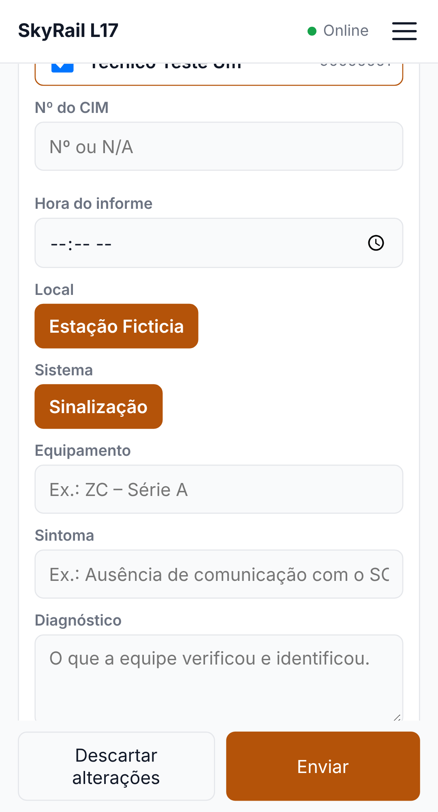
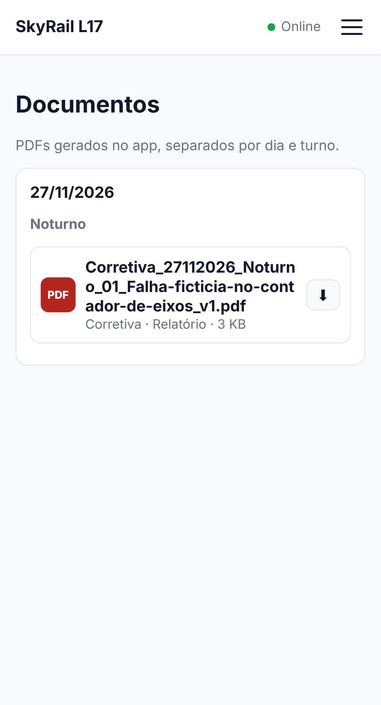
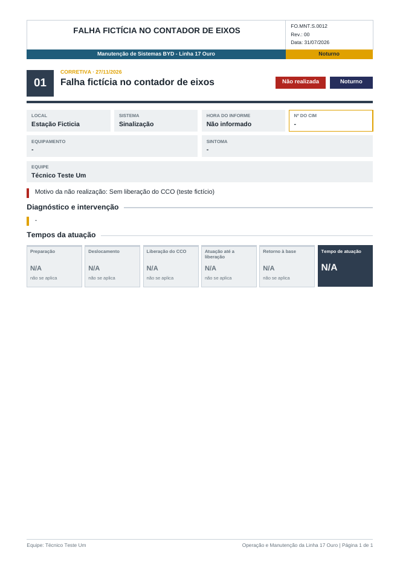

## O que muda
- **Testes das três filas de envio** (`data/envio.ts` de Relatório, Preventivas e Passagem) com um Supabase em memória
  (`src/test/supabaseFalso.ts`) que permite programar falhas. 15 casos, entre eles:
  sem internet nada sai do aparelho; servidor recusou guarda o erro e mantém rascunho e fotos;
  falha no meio das fotos não perde nenhuma e não reenvia a que já subiu; equipe por diferença;
  foto removida sai do banco e do Storage; mesmo turno da passagem vira uma linha só; só a fila de quem está logado.
- **Correção encontrada pelos testes:** a fila da Passagem não reenviava a passagem recusada pelo servidor
  (estado `erro`). Ela ficava parada até alguém tocar em Enviar. Agora é tentada de novo, como Relatório e Preventivas já faziam.
- **Teste ponta a ponta** (`npm run e2e`): login por RE → aceite da política → nova corretiva → enviar → gerar PDF →
  ver o PDF em Documentos, no Pixel 5, com Auth, REST e Storage simulados dentro do Playwright.
- Job **Ponta a ponta** no `ci.yml`, guardando prints e o PDF como artefato.

## Prova de teste
- `tsc -b`, `npx oxlint src scripts`, `npm test` (194 testes), `npm run build` e checagem de segredos passando.
- `npm run e2e` passou 3 vezes seguidas localmente, com **Supabase simulado** e **dados fictícios** ("Técnico Teste Um", RE 90000001).
- Só o teste ponta a ponta abre o app (prints abaixo, no Pixel 5). A correção da Passagem não muda nada na tela.

| Formulário (Pixel 5) | Documentos depois do envio (Pixel 5) | PDF gerado no teste |
|---|---|---|
|  |  |  |

Closes #31
